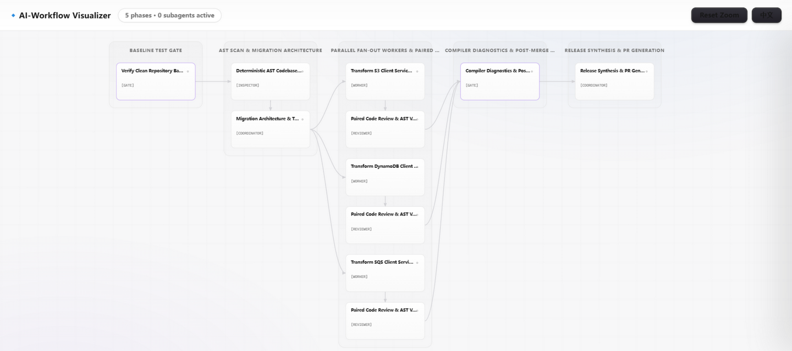

# AI-Workflow

> **The agentic workflow engine that compiles intent into code.**  
> *"Code, not conversation" — a TypeScript facade compiler, a sandboxed deterministic runtime,
> and a journalled engine that replays completed work at zero provider calls.*

[](LICENSE)
[](package.json)
[](https://github.com/LitaoG/AI-workflow-competition/actions/workflows/ci.yml)
[](https://litaog.github.io/AI-workflow-competition/)
[-red?logo=youtube)](https://youtu.be/wC9LOjNFfDo)
[-blueviolet)](deliverables/AI_Workflow_Video.mp4)

---

## 🎥 Demonstration Video · 演示视频 (1m 52s)

> **"Code, not conversation" in action** — Watch the full end-to-end multi-agent orchestration demonstration (2K QHD 60FPS, Microsoft Aria Neural Voiceover):

<div align="center">
  <a href="https://youtu.be/wC9LOjNFfDo" target="_blank" rel="noopener noreferrer">
    
  </a>
  <p>
    <strong><a href="https://youtu.be/wC9LOjNFfDo" target="_blank" rel="noopener noreferrer">▶ Click to Watch on YouTube (https://youtu.be/wC9LOjNFfDo)</a></strong><br>
    <em>Local Committed MP4: <a href="deliverables/AI_Workflow_Video.mp4">deliverables/AI_Workflow_Video.mp4</a> · GitHub Release: <a href="https://github.com/LitaoG/AI-workflow-competition/releases/download/v2.18.0/AI_Workflow_Video.mp4">v2.18.0 HD Download</a></em>
  </p>
</div>

---

## 1. Overview & Architecture · 项目介绍与核心架构

**AI-Workflow turns "agentic laziness, self-preferential bias, and goal drift" into compiled code.**
Instead of one agent hallucinating its way through an unconstrained multi-step job, you write a TypeScript
**facade script**: control flow is real code, every side effect goes through a compile-checked
facade (`agent().ask<T>()`, `files`, `git`, `world.run`, `artifact`), the entire execution is journalled,
and a re-run replays completed work at **zero provider calls**.

### Core Philosophy: Code, Not Conversation

- **Code, not conversation** — Branching, loops, and fan-outs are native TypeScript; the engine
  intercepts only facade calls. The worklist belongs to the script, making execution coverage
  structural rather than aspirational.
- **Deterministic zero-token replay** — Non-deterministic primitives such as `Date.now`, `Math.random`,
  and `new Date()` fail at compile time *and* in the sandbox realm. Relaunches replay byte-identically;
  iterating on a 50-step workflow costs tokens only for the exact steps you modified.
- **Evidence over claims** — Every execution node carries `(siteId, ordinal, inputHash)`. The SQLite-WAL
  journal — not the model's self-assessment — is the immutable source of truth.

### Four Failure Modes, Structurally Fixed

| Conversational Failure | Structural Fix in AI-Workflow |
| :--- | :--- |
| **Agentic laziness** — the model skips work or takes shortcuts | The script owns the worklist: e.g. the migration engine scans imports with a journalled `files.grep`, then fans out a worker+reviewer pair per file |
| **Self-preferential bias** — the author grades its own work | Every transform is reviewed by a *different* agent lens, and findings survive only if an independent verifier reproduces them |
| **Goal drift** — the plan erodes with context compaction | Each ask receives a fresh, narrow context with the goal restated; the plan lives in the script, impervious to token compaction |
| **Cost drift** *(the fourth, ours)* — iterative debugging re-bills everything | The deterministic journal short-circuits completed steps and replays them at zero token cost |

### The Engine Architecture (Evidence-Backed)

| Layer | Component | What Ships & How It Works | Verification Entry |
| :--- | :--- | :--- | :--- |
| **Compiler** | Facade Compiler | Strict TypeScript compilation against a single `.d.ts` in a virtual `CompilerHost`; AST authorization rules (purity bans, literal rules, shadowing, closed world); typed `ask<T>` → JSON-Schema synthesis | `node bin/workflow.js check <script>`; `src/dwf/compile.ts`, `src/dwf/schema-synth.ts` |
| **Sandbox** | Secure Runtime | Isolated child process + `node:vm` realm, NDJSON IPC, robust process tree supervision (POSIX process groups / Windows Win32 Job Object tree-kill, sanitized env) | `src/dwf/runner.ts`, `src/process-supervision.ts` |
| **Journal** | Deterministic SQLite WAL | `(runId, siteId, ordinal, inputHash)` short-circuit replay; loud hash-mismatch validation; escalation/hole parking; amend lineage (`♻` reuse / `⑂` diverge) | `node bin/workflow.js run-script --resume/--amend`; `src/dwf/engine.ts` |
| **Q&A / Human-in-the-loop** | Runtime Escalation & Holes | `escalate()` parks the workflow with a `dwfq-` id; `workflow answer` resumes at zero cost; `hole<T>()` allows dynamic workflow expansion mid-run | `tests/integration/dwf-escalation.test.ts`, `dwf-holes.test.ts` |
| **Human Surface** | Studio & Canvas | Journal-rendered interactive HTML reports, cubic-Bézier DAG canvases, loopback-only live server (`workflow serve`) | `src/dwf/view.ts`, `src/dwf/live.ts` |
| **Integration** | Harness & Protocol Face | Standard MCP server (10 tools: 5 facade + 5 legacy), Agent Skill (`skills/ai-workflow/`), external CLI provider adapters (`AI_WORKFLOW_PROVIDER=codex\|gemini\|opencode`) | `docs/INTEGRATION.md` |

### Rendered from the Journal, Not Hand-Made

The Studio view below is **generated directly from the run journal**: every node card, replay badge, and event stream line represents verified execution evidence (11 nodes, ⚡ 9 replays, live event timeline). The DAG canvas illustrates the worker + paired-reviewer fan-out of the migration engine.




---

## 2. Core Applications & Quick Preview · 核心示范应用与快速预览

AI-Workflow provides a clean, flexible structural foundation — lean enough to understand, robust enough to power complex autonomous multi-agent pipelines. The repository ships with **two independent, production-grade applications** built directly on this foundation:

> **One reusable engine** = facade compiler → sandboxed runtime → deterministic SQLite journal → journal-rendered Studio views.  
> **Two independent applications** = two distinct production domains, two facade scripts, zero shared demo logic.

| Dimension | Application 1 · `apps/incident-triage-remediation` | Application 2 · `apps/repo-migration-engine` |
| :--- | :--- | :--- |
| **Domain** | DevOps Incident Response & Auto-Remediation | Enterprise Codebase Modernization |
| **Scenario** | **P1 database connection pool exhaustion**: 100/100 DB connections, 38.5% HTTP 500 spike | **AWS SDK v2 → v3** migration across a multi-module repository (S3, DynamoDB, SQS) |
| **Pipeline (5 phases)** | Deterministic probe → typed triage ask → planner + independent safety reviewer → deterministic recovery gate → post-mortem report | Baseline test gate → AST/deprecation scan → parallel worker+reviewer fan-out per file → `tsc --noEmit && npm test` merge gate → PR synthesis |
| **Safety & Verification** | Destructive commands (`DROP`, `TRUNCATE`, `rm -rf`) intercepted by deterministic blacklist; automated rollback on gate failure | Every patch verified by an independent reviewer before passing the compiler & unit test gate |
| **Deliverables** | `PostMortem.md`, `kanban.json`, interactive `incident_dag.html` | Publication-ready `PULL_REQUEST.md`, `migration_dag.html` |

In addition, [`apps/capabilities-tour`](apps/capabilities-tour) provides a reusable pattern library (amend lineage, hole growth, human escalation, budget hard limits) that demonstrates the advanced orchestration primitives of the engine.

### 🧭 3-Minute Quickstart & Architecture Tour · 3 分钟极速上手与全景体验

Experience the system instantly through three progressive channels:

| Channel | Time & Form | Highlights & Verification Points | Quick Entry |
| :--- | :--- | :--- | :--- |
| ⚡ **Path A** | **30 秒** · 零安装直达 | **全景矢量拓扑、四大失效结构解法、真实 9 幕实录**<br>浏览器零依赖即开即看，微拟态纯白美学，完整呈现架构分层、基准测试与 9 幕运行实录证据链 | 🔗 [Live Showcase 交互演示单页](https://litaog.github.io/AI-workflow-competition/) |
| 🚀 **Path B** | **60 秒** · 单命令全景实测 | **48 秒九幕全景直通，零 Token 确定性重放**<br>本地克隆后一键运行，离线验证严格编译、沙箱隔离、时间旅行、孔洞填补与预算硬门禁 | `git clone ...`<br>`npm install && npm run build`<br>`npm run demo` |
| 📊 **Path C** | **90 秒** · 可视化看板与实测应用 | **时间旅行可视化画布，直达两个真实子应用**<br>自动唤起浏览器 Studio 看板，探索 DevOps 突发故障自愈与 AWS SDK 自动化迁移应用 | `npm run demo:studio`<br>*(自动在浏览器打开 Studio)* |

---

## 3. Local Installation & Reproduction · 本地安装与快速上手

### Prerequisites
- **Node.js**: `>= 22.0.0`
- **Git**

### Install from Source

```bash
# 1. Clone repository
git clone https://github.com/LitaoG/AI-workflow-competition.git
cd AI-workflow-competition

# 2. Install dependencies & compile
npm install
npm run build

# 3. Run cross-platform demo (fast, ~2s, offline mock mode)
node bin/workflow.js demo
# or: npm run demo

# 4. Open interactive Studio canvas in your default browser
npm run demo:studio

# 5. (Optional) Run the full nine-act self-verifying showcase (~48s)
bash scripts/demo.sh
# or: npm run demo:nine-acts          (requires Bash / Git Bash on Windows)
node scripts/demo-nine-acts.mjs
# or: npm run demo:nine-acts:win      (Windows PowerShell native — no Bash needed)
```

> **Artifacts note:** workflow products (PostMortem, DAG views, kanban) are written relative to the **run's working directory** (cwd). Root-level `artifacts/` holds the latest outputs of repo-root-cwd runs — the demo chain rewrites it, and `git restore artifacts/` restores the tracked baseline. `apps/<app>/artifacts/` holds outputs of runs executed with that app directory as the cwd (Issue #255).

> **Install Note:** This repository is not published to npm under `ai-workflow` (that name is an unrelated 2021 placeholder). You can install from source as above or download pre-packaged `.tgz` assets from [GitHub Releases](https://github.com/LitaoG/AI-workflow-competition/releases):
> ```bash
> gh release download --repo LitaoG/AI-workflow-competition --pattern "*.tgz"
> npm install ./ai-workflow-<version>.tgz
> ```

### Command-Line Interface Reference

The CLI entrypoint is `bin/workflow.js` (or `workflow` when linked):

```bash
# Check a facade script for purity, closed-world, and syntax compliance
node bin/workflow.js check <path/to/script.facade.ts>

# Execute a facade script with journal recording
node bin/workflow.js run-script <path/to/script.facade.ts> --cwd <workspace>

# Resume a paused or failed run (completed nodes replayed at zero token cost)
node bin/workflow.js run-script <path/to/script.facade.ts> --resume <runId>

# Launch the live interactive Web Studio for a journal database
node bin/workflow.js serve <runId> --db .workflow/dwf.sqlite
```

---

## 4. Harness & Host Integration · 智能体宿主与工具链接入

AI-Workflow operates as an **independent CLI**, an **MCP Server**, and an **embeddable library**, allowing seamless integration into any modern Coding Agent CLI or Agent Harness.

### 4.1 Integration with External Coding Agent CLIs

Route agent asks directly to existing command-line AI tools already on your system:

```bash
# Delegate ask calls to Codex CLI
AI_WORKFLOW_PROVIDER=codex node bin/workflow.js run-script my-flow.facade.ts

# Delegate ask calls to Gemini CLI
AI_WORKFLOW_PROVIDER=gemini node bin/workflow.js run-script my-flow.facade.ts

# Delegate ask calls to OpenCode
AI_WORKFLOW_PROVIDER=opencode node bin/workflow.js run-script my-flow.facade.ts

# Explicit binary override (optional)
AI_WORKFLOW_CLI_COMMAND='C:\bin\codex.exe' node bin/workflow.js run-script my-flow.facade.ts
```

### 4.2 Direct HTTP Model Providers

The engine natively discovers and binds standard LLM provider credentials from environment variables (with zero extra runtime dependencies):

```bash
export ANTHROPIC_API_KEY=sk-ant-...   # Provider 'anthropic' (optional ANTHROPIC_MODEL)
export OPENAI_API_KEY=sk-...          # Provider 'openai' (optional OPENAI_MODEL)
export AWS_ACCESS_KEY_ID=... AWS_SECRET_ACCESS_KEY=... # Provider 'bedrock' (native SigV4)
```

### 4.3 Harness & MCP Host Mounting (Claude Code, Cursor, Kiro, ZCode)

Mount AI-Workflow as a standard Model Context Protocol (MCP) server over stdio:

```json
{
  "mcpServers": {
    "ai-workflow": {
      "command": "node",
      "args": ["<path-to-repo>/bin/workflow.js", "mcp", "serve"]
    }
  }
}
```

**Exposed MCP Tool Surface (10 Tools)**:
- **Facade Tools**: `workflow_script_check`, `workflow_script_run`, `workflow_run_script`, `workflow_inspect_run`, `workflow_get_run`
- **Legacy Builder Tools**: `workflow_run`, `workflow_probe`, `workflow_inspect`, `workflow_replay`, `workflow_graph`

### 4.4 Agent Skill Packaging

Mount `skills/ai-workflow/` (carrying `SKILL.md` and facade authoring templates) into any host supporting open Agent Skills:
- **Claude Code**: Link into `~/.claude/skills/ai-workflow/`
- **Codex CLI**: Reference in system prompt or `AGENTS.md`
- **Cursor / OpenCode**: Load skill directory directly

### 4.5 Kiro Governance Subsystems

AI-Workflow provides a first-class root `.kiro/` governance integration:
- **Specs** (`.kiro/specs/`): Formal state machine, Kahn-algorithm DAG invariant, and typed RPC contract.
- **Hooks** (`.kiro/hooks/`): Lifecycle interceptors (`SessionStart` probe, `PreToolUse` shell gate, `PostToolUse` audit, `Stop` decision).
- **Steering** (`.kiro/steering/`): Standing frontmatter policies for security and conventions.
- **PBT** (`.kiro/pbt/`): Property-based invariant test suite (`fast-check`).

*For in-depth integration documentation, see [`docs/INTEGRATION.md`](docs/INTEGRATION.md) and [`docs/KIRO_INTEGRATION.md`](docs/KIRO_INTEGRATION.md).*

---

## 5. Quality Assurance & Verification · 质量保证与系统验证

### Reproducible Quality Gate Fingerprints

All test suites execute offline in deterministic mock mode without API keys. Fresh-build numbers on the current tree:

```text
npm test                                            → 905 tests, 902 pass, 3 skipped, 0 fail
npm run test:integration (serial)                   → 215 tests, 215 pass, 0 skipped, 0 fail
npm run test:pbt                                    →  18 tests,  18 pass, 0 fail
node --experimental-strip-types tests/e2e/runner.ts → 118/118 passed
npm run test:adversarial                            → 198 tests, 198 pass, 0 fail
npm run test:governance                             →  47 tests,  47 pass, 0 fail
npm run demo:nine-acts                              → ~45s, exit 0, all nine acts OK
```

### Cross-Engine Benchmark (Measured)

A bilateral benchmark executing the identical facade script (planner → 4-way fan-out → verifier self-heal → report) on both our engine and the official ZCode dynamic-workflow engine demonstrates:
- **Warm Compile**: **7.206 ms** (ours) vs 51.072 ms (reference)
- **Peak Heap Memory**: **40.54 MB** (ours) vs 100.18 MB (reference)
- **Peak RSS**: **147.7 MB** (ours) vs 235.88 MB (reference)
- **Determinism**: 100% byte-identical event sequences across runs.

Full analysis: [`docs/research/BILATERAL-CROSS-BENCHMARK-REPORT.md`](docs/research/BILATERAL-CROSS-BENCHMARK-REPORT.md).

<a id="compliance"></a><a id="compliance--security"></a><a id="compliance-security"></a>
### Compliance & Security

1. **Clean-room implementation**: The facade compiler, sandbox runtime, deterministic SQLite journal, and view subsystems are original work.
2. **Apache-2.0 License**: Fully open-source and permissible for enterprise adoption.
3. **Supply Chain Security**: All dependencies pinned via `package-lock.json`; `npm audit --omit=dev` reports 0 vulnerabilities.
4. **Zero Private Data Leakage**: All telemetry and test fixtures are synthetic; credentials (`AKIA...`, JWTs) are automatically redacted in persisted logs.

---

## 6. Project Origins, Acknowledgments & License · 项目溯源与致谢

### Project Origins

AI-Workflow was originally created as an exploration project for the **2026 Kiro Hackathon** (Skeleton Crew track, hosted by Kiro on Devpost), answering the challenge of replacing fragile multi-agent chat chains with compiled, deterministic, and verifiable TypeScript workflows. It has since matured into an independent, production-grade agentic workflow execution engine. For historical context and original hackathon submission materials, see [SUBMISSION.md](SUBMISSION.md).

### Acknowledgments

- **Kiro / AWS** and **Devpost** for organizing Kiroween 2026 and providing the catalyst for this architecture.
- **ZCode** for the pioneering dynamic-workflow concepts that inspired our engine design.
- The open-source ecosystem that powers our foundations:
  - [fast-check](https://fast-check.dev/) — Property-based testing and invariant verification.
  - [zod](https://zod.dev) — Type-safe schema validation.
  - [@modelcontextprotocol/sdk](https://modelcontextprotocol.io) — Standard MCP communication.
  - [Node.js](https://nodejs.org) — Execution runtime.

### License

Released under the [Apache License 2.0](LICENSE).

---

**Further Reading** — [Quickstart (60-second tour)](QUICKSTART.md) ·
[Architecture Deep-Dive](docs/ARCHITECTURE.md) ·
[Integration Guide](docs/INTEGRATION.md) ·
[Kiro Governance & Specs](docs/KIRO_INTEGRATION.md) ·
[Showcase Page](docs/showcase.html) ([Live](https://litaog.github.io/AI-workflow-competition/))
