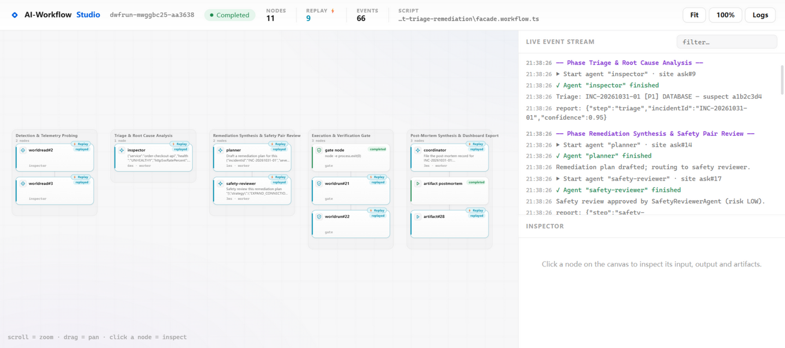

# AI-Workflow

> **The agentic workflow engine that compiles intent into code.**
> *"Code, not conversation" — a TypeScript facade compiler, a sandboxed deterministic runtime,
> and a journalled engine that replays completed work at zero provider calls.*

[](SUBMISSION.md)
[](LICENSE)
[](package.json)
[](https://github.com/LitaoG/AI-workflow-competition/actions/workflows/ci.yml)

**AWS Kiroween 2026 submission — Skeleton Crew category** (hosted by Kiro on Devpost).

---

## The 30-second pitch

**AI-Workflow turns "agentic laziness, self-preferential bias, and goal drift" into compiled code.**
Instead of one agent hallucinating its way through a multi-step job, you write a TypeScript
**facade script**: control flow is real code, every side effect goes through a compile-checked
facade (`agent().ask<T>()`, `files`, `git`, `world.run`, `artifact`), the whole run is journalled,
and a re-run replays completed work at **zero provider calls**.

- **Code, not conversation** — branching, loops and fan-outs are native TypeScript; the engine
  intercepts only facade calls. Coverage is structural, not aspirational.
- **Deterministic zero-token replay** — `Date.now`, `Math.random` and `new Date()` fail at compile
  time *and* again in the sandbox realm, so relaunches replay byte-identically; iterating on a
  50-step workflow costs tokens only for the steps you actually changed.
- **Evidence over claims** — every node carries `(siteId, ordinal, inputHash)`; the journal — not
  the model's word — is the source of truth.

### Three failure modes, structurally fixed

| Conversational failure | Structural fix |
| --- | --- |
| **Agentic laziness** — the model skips work | The script owns the worklist: the migration demo scans `aws-sdk` imports with a journalled `files.grep`, then fans out a worker+reviewer pair per file |
| **Self-preferential bias** — the author grades its own work | Every transform is reviewed by a *different* agent, and findings survive only if an independent verifier reproduces them |
| **Goal drift** — the plan erodes with context compaction | Each ask gets a fresh, narrow context with the goal restated; the plan lives in the script, so compaction cannot erode it |
| **Cost drift** *(the fourth, ours)* — iterating re-bills everything | The journal replays completed work at zero provider calls |

---

## See it — rendered from the journal, not hand-made

The Studio view below is **generated from the run journal itself**: every node card, replay
badge and event line is journalled evidence (11 nodes, ⚡ 9 replays, live event stream), not a
mockup. The second image is the DAG canvas of the migration demo — the fan-out of worker +
paired reviewer per file that structurally fixes agentic laziness.




---

## One skeleton, two applications

The Skeleton Crew category asks for a **flexible, clean structural code template** — lean enough
to be clear, flexible enough to support various use cases — that empowers autonomous multi-agent
engineering without chaotic prompt-chasing. Our answer is a single engine skeleton, and **two
independent, production-grade applications built on it**:

> **One skeleton** = facade compiler → sandboxed runtime → deterministic SQLite journal →
> journal-rendered human views. **Two applications** = two unrelated domains, two facade scripts,
> zero shared demo logic.

| | Application 1 · `apps/incident-triage-remediation` | Application 2 · `apps/repo-migration-engine` |
| --- | --- | --- |
| Domain | DevOps incident response | Enterprise library migration |
| Scenario | **P1 database connection pool exhaustion**: 100/100 DB connections, 38.5% HTTP 500 spike | **AWS SDK v2 → v3** across a multi-module codebase (S3, DynamoDB, SQS) |
| Pipeline (5 phases) | deterministic probe → typed triage ask → planner + independent safety reviewer → deterministic recovery gate → post-mortem report | baseline test gate → AST/deprecation scan → parallel worker+reviewer fan-out per file → `tsc --noEmit && npm test` merge gate → PR synthesis |
| Safety | destructive commands (`DROP`, `TRUNCATE`, `rm -rf`) intercepted by a deterministic blacklist; automated rollback when the verification gate fails | every patch passes an independent reviewer before the compiler gate |
| Deliverables | `PostMortem.md`, `kanban.json`, interactive `incident_dag.html` | publication-ready `PULL_REQUEST.md`, `migration_dag.html` |

A third directory, [`apps/capabilities-tour`](apps/capabilities-tour), is the reusable pattern
library — amend lineage, hole growth, human escalation, budget enforcement — that powers acts 5–8
of the demo below. Write a new facade script in any domain and the same skeleton carries it.

### The engine skeleton, layer by layer (evidence-backed)

| Layer | What ships | Where to verify |
| --- | --- | --- |
| Facade compiler | Strict TS against a single `.d.ts` in a virtual CompilerHost; AST authorization rules (purity bans, literal rules, shadowing, closed world); `ask<T>` → JSON-Schema synthesis from JSDoc | `workflow check <script>`; `src/dwf/compile.ts`, `src/dwf/schema-synth.ts` |
| Sandbox | Child process + `node:vm` realm, NDJSON IPC, process supervision (POSIX process groups / Windows tree-kill / sanitized child env) | `src/dwf/runner.ts`, `src/process-supervision.ts` |
| Deterministic journal | SQLite WAL: `(runId, siteId, ordinal, inputHash)` short-circuit replay; loud hash-mismatch failures; escalation/hole parking; amend lineage | `workflow run-script --resume/--amend`; `src/dwf/engine.ts` |
| Runtime Q&A | `escalate()` parks the run with a `dwfq-` id; `workflow answer` resumes at zero cost; `hole<T>()` grows the workflow mid-run | `tests/integration/dwf-escalation.test.ts`, `dwf-holes.test.ts` |
| Human surface | `workflow view <runId>` (journal-rendered HTML report), `workflow serve` (live, self-refreshing), ASCII/HTML DAG | `src/dwf/view.ts`, `src/dwf/live.ts` |
| Integration | MCP tools (`workflow_script_check/run`), agent skill (`skills/ai-workflow/`), CLI providers (`AI_WORKFLOW_PROVIDER=codex\|gemini\|opencode`) | `docs/INTEGRATION.md` |

---

## The three-minute judge experience

```bash
git clone https://github.com/LitaoG/AI-workflow-competition.git
cd AI-workflow-competition
npm install && npm run build
bash scripts/demo.sh
```

Offline, deterministic, **no API keys** — the script self-verifies and exits non-zero if any act
fails. Measured end-to-end on this machine (2026-11-03, Git Bash on Windows, Node v26.13.0, warm
npm cache; fresh `node_modules`/`dist`): **42 seconds, exit 0, `ALL NINE ACTS COMPLETE`** — well
inside the three-minute budget, with headroom for a cold registry.

Every act prints the evidence line for the capability it demos:

| Act | Capability | Evidence line |
| --- | --- | --- |
| 1 | strict compile + phase graph | `✔ facade script compiled clean (35 sites)` |
| 2 | sandbox run (incident demo) | `✔ run dwfrun-… completed` |
| 3 | **zero-token replay** | `⚡ replayed from journal: … (0 provider calls)` |
| 4 | migration demo | `asks: 8 (replayed from journal: 0)` → `result: {"migrated":3,…,"gates":"passed"}` |
| 5 | **amend lineage** | `♻ amended run reused` + `⑂ diverged (executing live)` |
| 6 | **hole growth** | `⏸ parked at hole` → `✔ hole filled; forked run completed` |
| 7 | **human escalation** | `dwfq-…` → `✔ run completed with the answer in hand` |
| 8 | **budget hard enforcement** | `WorkflowBudgetExceededError` caught by the script |
| 9 | journal-rendered report + live attach | `.workflow/views/demo.html` + `workflow serve <runId>` |

Act 9 leaves an interactive HTML run report at `.workflow/views/demo.html` — every node, timing and
journal event rendered as a standalone page. Attach live during a run with
`node bin/workflow.js serve <runId> --db .workflow/demo-dwf.sqlite` and open
`http://127.0.0.1:4649/` (the `--db` flag is required: the demo journals to
`.workflow/demo-dwf.sqlite`, while the CLI's default database path is `.workflow/dwf.sqlite`).

🎬 A demo video (<3 minutes, per the official submission requirements) is being recorded — the
placeholder and recording recipe live in [`SUBMISSION.md`](SUBMISSION.md).

### Reproducible quality-gate fingerprints

All run on this machine, 2026-11-15 (Node v26.13.0), from a **fresh build** (a stale `dist/` can
double-count one moved test file — the fresh-build numbers below are what a judge clone reproduces):

```text
npm test                                          → 807 tests, 807 pass, 0 fail
node --experimental-strip-types tests/e2e/runner.ts → 118/118 passed (4 tiers)
npm run test:adversarial                          → 202 tests, 202 pass, 0 fail
npm run test:pbt                                  →  16 tests,  16 pass, 0 fail
npm run test:governance                           →  37 tests,  37 pass, 0 fail
bash scripts/demo.sh                              → exit 0, all nine acts OK
```

Both demo applications also run standalone (offline mock mode, `--lang zh` for Chinese
presentation) — see their READMEs:
[`incident-triage-remediation`](apps/incident-triage-remediation/README.md) ·
[`repo-migration-engine`](apps/repo-migration-engine/README.md).

---

## Kiro integration: specs, hooks, steering, MCP, PBT

AI-Workflow treats Kiro not as a chat window but as a governance surface. The root
[`.kiro/`](.kiro) directory is **fully tracked in Git** and carries five subsystems
(full guide: [`docs/KIRO_INTEGRATION.md`](docs/KIRO_INTEGRATION.md)):

- **Specs** (`.kiro/specs/`) — formal workflow-engine semantics (state machine, Kahn-algorithm DAG
  invariant, typed `agent(name).ask<T>(prompt, schema)` RPC contract) plus machine-readable JSON
  schemas and state-replay invariants (`State(k) = Fold(Events[0..k])`).
- **Hooks** (`.kiro/hooks/`) — lifecycle gates on `AgentSpawn` (deterministic environment probe),
  `PreToolUse` (destructive-command interception, exit-code-2 blocking), `PostToolUse`
  (append-only event-stream audit) and `Stop` (no session exit until verification gates pass).
- **Steering** (`.kiro/steering/`) — frontmatter (`inclusion: always`) guardrails: "code, not
  conversation" philosophy, security policy (destructive shell syntax banned, credentials
  sanitized, sandbox isolation), workflow conventions, bilingual presentation.
- **MCP** (`.kiro/mcp/mcp-server.json`) — exposes the engine to Kiro over stdio, including the
  `workflow_script_check` / `workflow_script_run` tools.
- **PBT** (`.kiro/pbt/`) — `fast-check` property-based tests proving 5 invariants (50–100
  randomized cases per property, see `.kiro/pbt/engine-invariants.test.ts`): DAG acyclicity,
  idempotent zero-token replay, typed-RPC contract soundness, monotonic event-log ordering, and
  credential redaction (AWS keys / JWTs → `***REDACTED***` in persisted logs).

And the namesake: the **Skeleton Crew roster** (`.kiro/crew/`) — `Conductor`, `Prober`, `Worker`,
`Reviewer`, `GateKeeper` — with least-privilege permission ceilings per role.

---

## Why this maps to the judging dimensions

| Kiroween 2026 dimension | Where this repo scores |
| --- | --- |
| **Potential Impact** | The four failure modes above are endemic to every multi-agent deployment; zero-token replay turns workflow iteration economics from "re-bill everything" into "bill only the diff" |
| **Technological Implementation** | Compile-time purity bans, a real sandbox (child process + `node:vm`, process supervision), SQLite WAL journal with hash-verified replay, PBT-proven invariants |
| **Design** | Journal-rendered interactive HTML reports, cubic-Bézier DAG canvases, live Kanban tracking — presentation generated from evidence, not hand-made |
| **Innovation** | Amend lineage (`♻` reuse / `⑂` diverge), mid-run hole growth, human escalation with zero-cost resume, hard budget enforcement |
| **Presentation** | One command, nine acts, self-verifying, offline — plus a single-file [showcase page](docs/showcase.html) |

**Contest facts** — AWS Kiroween 2026, hosted by Kiro on Devpost; USD 100,000 prize pool;
submissions close **December 4, 2026, 2:00 PM PT**; judged on Potential Impact, Technological
Implementation, Design, Innovation, and Presentation.

---

## Compliance

1. **Original clean-room implementation.** The facade compiler, sandbox runtime, deterministic
   journal and view system are original work authored for this project. ZCode's dynamic-workflow
   model is cited as design inspiration only; no third-party proprietary code is incorporated.
2. **Apache-2.0 license.** The entire repository is distributed under the Apache License 2.0
   ([LICENSE](LICENSE)).
3. **Dependency supply chain.** All dependencies are version-pinned via `package-lock.json`. The
   one high advisory (GHSA-mrhx-c7xc-m3w5 in `zod` 3.25.76) is **fixed**: the runtime dependency
   now pins `zod` **4.6.7** (the official fix version), migrated in a worktree and verified by a
   journalled facade-script gate pipeline (tsc, 695 unit/integration, 121 E2E, 158 adversarial,
   16 PBT, nine-act demo, `npm audit --omit=dev` → 0). `npm audit` now reports 4 moderate
   advisories, all in dev dependencies.
4. **Zero private data leakage.** All demo scenarios, telemetry and fixtures are synthetic; every
   demo and test runs offline in mock mode with zero API keys; environment probing redacts
   credentials (`AKIA…`, JWTs → `***REDACTED***`, enforced by a PBT invariant). No private keys,
   credentials, proprietary sources or personal data are committed.

---

## License & acknowledgments

Released under the [Apache License 2.0](LICENSE).

With thanks to **Kiro / AWS** and **Devpost** for Kiroween 2026; to **ZCode** for the
dynamic-workflow design that inspired this engine; and to the open-source projects that carry it:
[fast-check](https://fast-check.dev/) (property-based testing),
[zod](https://zod.dev) (runtime schema validation),
[@modelcontextprotocol/sdk](https://modelcontextprotocol.io) (MCP integration), and
[Node.js](https://nodejs.org) ≥ 22.

---

**Further reading** — [Judge navigator & pitch](SUBMISSION.md) ·
[Kiro integration & compliance](docs/KIRO_INTEGRATION.md) · [Architecture](docs/ARCHITECTURE.md) ·
[Integration guide](docs/INTEGRATION.md) · [Showcase page](docs/showcase.html)
