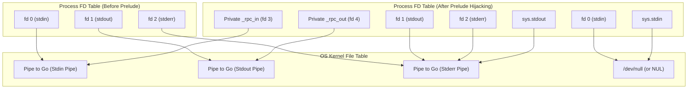
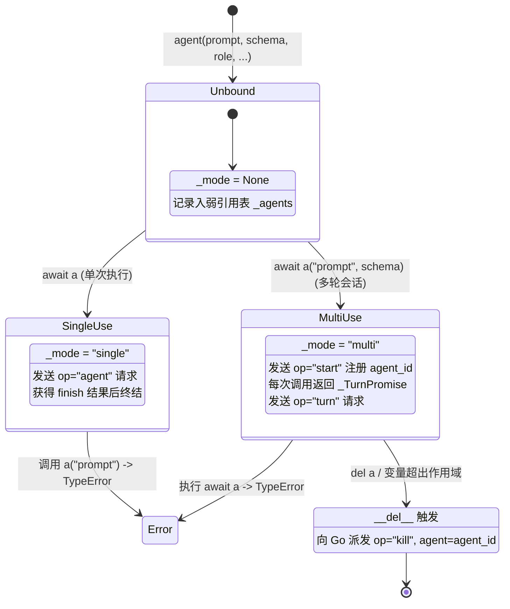

# Google Antigravity 原生动态工作流（run_workflow）架构深度逆向与四大多智能体谱系对标白皮书

> **版本**：1.0（2026-11-14）  
> **研究基准**：Google Antigravity 2.0 原生运行时（Go `language_server.exe` 核心守护进程 + Python 3.8+ 动态工作流 Prelude 注入层）  
> **对标对象**：  
> 1. ZCode 官方 Dynamic Workflow（动态 DAG 编排与类型推导引擎）  
> 2. Claude Code 原生 Dynamic Workflow（Anthropic `@anthropic-ai/claude-code@2.1.316` VM 沙箱）  
> 3. AI-workflow（本仓 Project Y：TypeScript Facade 编译器 + Node.js 沙箱 + Win32 Job Object / cgroups + SQLite WAL 事件账本）  
> 4. Google Antigravity（本白皮书主体：Go LSP 宿主 + OS 隔离 Python 解释器 + 系统级 FD 劫持 RPC）  
> **证据等级**：全文结论按 `[已验证]` / `[推断]` / `[未知]` 标注；无直接运行或源码证据的推断严禁写成既成事实。  
> **清洁室声明**：本文记录行为语义、接口契约、系统调用管道模型、协议帧结构与架构设计思想；落地实现完全遵循本仓 TypeScript/Node.js 向内依赖架构独立实现，严禁代码侵权。

---

## 0. 执行摘要

Google Antigravity 在近期版本中正式推出原生动态工作流能力（由 `/run-workflow` 技能与 `run_workflow` 原生工具驱动），全面废弃早期以纯 Prompt / Markdown 描述的静态工作流模版（配套 `migrate-workflows` 迁移工具），走向纯代码编排（Code as Workflow）。

经实机逆向剖析其 Go 宿主（`language_server.exe`）与 Python 动态注入 Prelude（`antigravity_workflow_prelude.py`，共 1334 行），揭示了其在工业级多智能体编排领域极具工程价值的架构创新：

1. **操作系统级文件描述符劫持（FD Hijacking）彻底隔离 RPC 管道**：在 Python 解释器启动的第一微秒，通过 `os.dup(0/1)` 克隆私有通信描述符，随即通过 `os.dup2` 将物理 `fd 0` 绑定至 `/dev/null`、`fd 1` 绑定至 `fd 2`（`stderr`），并将 `sys.stdout` 强制指向 `sys.stderr`。这一设计使得任何用户代码、第三方库调用 `print()` 或派生子进程的控制台输出在内核层被重定向，物理上绝对无法向 RPC 信道写入脏字节，从根源上彻底免疫 NDJSON 协议投毒攻击（彻底解决协议健壮性痛点）。
2. **终态未 Await 挂起 Promise / Agent 自动审计防御**：通过全局注册表 `_tracked` 与弱引用表 `_agents` 记录所有派生异步任务与智能体定义，在工作流脚本退出前实施全局扫描。若存在任何被定义但未被 `await` 的悬挂 Promise，立即终止退出流程并抛出致命错误 `workflow execution failed: <label> was never awaited`，彻底终结了模型生成脚本中因遗漏 `await` 导致的「任务未跑却报成功」的假绿（Fake Green）顽疾。
3. **双模态 Agent 生命周期与弱引用 GC 协同**：提供单次执行模式（`await agent(prompt, schema)`）与长程多轮会话模式（`await a(prompt, schema)`），两模式在状态机上严格互斥；通过 `weakref` 弱引用与 Python `__del__` 析构钩子，在变量脱离作用域时自动通过事件循环派发 `kill` 通知，由 Go 宿主精准回收远端大模型上下文资源。
4. **基于 `contextvars` 的分层多维预算控制体系（`with_budget`）**：在协程上下文栈中精确追踪 Token 消耗、并发 Agent 实例数与墙钟超时，支持任意深度的预算嵌套；在并发任务失败取消时，精准清理未启动任务并注销泄漏检查标签，兼顾严密性与并发健壮性。
5. **历史轨迹反查与元数据内省（`await trajectory(...)`）**：允许脚本内省主会话中已发生的前序步骤（命令输出、工具入参、错误堆栈），按步索引、类型与工具名精细过滤，免去重复运行副作用工具或再次付费调用模型的开销。
6. **纯内存动态模块装载（`_LibraryFinder`）**：实现 `importlib.abc.MetaPathFinder` 与 `Loader`，Go 宿主在握手帧中以内存字符串形式注入依赖工作流库，Python 直接在内存中编译执行，并设置 `sys.dont_write_bytecode = True` 严禁 `.pyc` 字节码落盘，消除磁盘篡改与文件残留隐患。

---

## 1. 研究方法与证据边界

### 1.1 证据来源表

| 证据载体 | 物理路径 / 出处 | 核心验证内容与证据用途 |
|---|---|---|
| **Antigravity Prelude 注入源** | 本机 Antigravity 安装的 brain/scratch 会话产物（`antigravity_workflow_prelude.py`，1334 行；机器本地 UUID 路径不随仓分发，见 §5.1） | 逆向完整运行时：FD 劫持、NDJSON 帧循环、未 Await 扫描、`with_budget`、`_LibraryFinder` |
| **Antigravity Skill 规约** | `<local-machine>/.gemini/antigravity/builtin/skills/run-workflow/SKILL.md` | 原生 API 契约、`type_name` / `workspace` 三态、`finish` 工具契约、`trajectory()` 规约 |
| **Claude Code 白皮书** | `docs/research/CLAUDE-CODE-DYNAMIC-WORKFLOW-WHITEPAPER.md` | 官方 `@anthropic-ai/claude-code@2.1.316` VM 沙箱、Date 纯度封印、并发门对标 |
| **ZCode 逆向报告** | `docs/research/workflow-reverse-engineering.md` & `ZCODE-DEEP-REVERSE-v2.md` | ZCode 三代演进、AST 静态门禁、动态 DAG 拓扑调度对标 |
| **AI-workflow 引擎源码** | `src/dwf/`、`src/core/`、`src/process-supervision.ts`、`src/state/` | 现有 Facade 架构、Job Object 监管、SQLite WAL 事件账本对标 |
| **攻防与缺口基线** | `docs/research/PENETRATION-AND-SECURITY-AUDIT.md` & `WORKFLOW-GAP-MATRIX.md` | NDJSON 投毒攻防（D4）、未 Await 挂起泄漏风险对标 |

### 1.2 证据分档标准

- **`[已验证]`**：由当前机器的真实文件路径、精确代码行号或实机运行命令直接支撑，第三方可逐字复现。
- **`[推断]`**：根据已验证源码逻辑与系统调用规范推导得出的结论，文中明确说明每一步逻辑链。
- **`[未知]`**：受限于 Go 闭源二进制编译优化或未开放接口，尚未捕获运行时具体状态，明确列出信息缺口。

### 1.3 清洁室声明与安全边界

本白皮书针对公开注入脚本与工具规约进行纯技术架构对标。所有反向推导内容仅用于指导本仓 `AI-workflow` 的安全性加固与契约演进，严禁直接复制粘贴闭源脚本代码；本仓后续实现均在 TypeScript/Node.js 运行时中独立编码完成。

---

## 2. Antigravity 动态工作流架构深度逆向

### 2.1 双进程拓扑与宿主-解释器分工

Antigravity 采用 **Go 核心守护进程 + 动态派生 Python 子进程** 的物理双进程架构。不同于 Claude Code 将工作流置于 Node.js 宿主内部的 `vm.createContext` 中执行，Antigravity 将用户编写的动态工作流完全隔离在独立的 OS 进程边界外。

```mermaid
sequenceDiagram
    autonumber
    participant Go as Go Host (language_server.exe)
    participant Kernel as OS Kernel (Process / FD Table)
    participant Py as Python Subprocess (prelude.py)
    participant Loop as Python asyncio Event Loop
    participant Script as User Dynamic Workflow Script

    Go->>Kernel: Spawn python.exe -u - (stdin=pipe0, stdout=pipe1, stderr=pipe2)
    Note over Py,Kernel: Prelude 初始化阶段
    Py->>Kernel: os.dup(0) -> _rpc_in, os.dup(1) -> _rpc_out
    Py->>Kernel: os.dup2(devnull, 0), os.dup2(2, 1)
    Py->>Kernel: sys.stdin = /dev/null, sys.stdout = sys.stderr
    Note over Py: 物理级 RPC 通道建立，标准输出被重定向至 stderr

    Go->>Py: Init Frame (script, args, context, libraries, call_tool)
    Py->>Py: sys.meta_path 挂载 _LibraryFinder (内存纯加载)
    Py->>Py: AST 预编译 (PyCF_ALLOW_TOP_LEVEL_AWAIT)
    Py->>Loop: 启动后台读取守护线程 _read_replies()
    Py->>Loop: 启动脚本协程 _run_script()

    loop 异步执行与 RPC 交互
        Script->>Loop: await agent(...) / await call_tool(...)
        Loop->>Go: {"op": "agent"|"call_tool", "id": 1, ...} via _rpc_out
        Go-->>Loop: {"id": 1, "result": {...}} via _rpc_in
        Loop-->>Script: 返回反序列化结果
    end

    Note over Py,Script: 脚本执行完毕，进入终态扫描门禁
    Py->>Py: 审计 _tracked 与 _agents 未 Await 集合
    alt 存在未 Await 的 Promise 或 Agent
        Py->>Go: {"op": "error", "error": "workflow execution failed: ... was never awaited"}
    else 全部正常 Await
        Py->>Go: {"op": "done"}
    end
    Go->>Py: 关闭 RPC 管道 / 终止进程
```

`[已验证]` 语义锚：prelude 初始化段（FD 劫持）与终态审计段。（清洁室注：被逆向文件不随本仓分发，本文一律以**行为级还原**承载结论，不收录逐字源码。）

### 2.2 文件描述符劫持与物理级 RPC 管道隔离

在多进程通信中，子进程中的第三方代码、未被捕获的 `print()`、或者外部命令（通过 `subprocess.run` 派生）直接向标准输出（`fd 1`）打印诊断日志，是导致 NDJSON 协议解析崩溃（JSON Parse Error）甚至协议投毒的头号元凶（本仓 D4 漏洞根因）。

Antigravity 在脚本加载前，通过微内核级的 FD 劫持技术彻底解决了这一难题。行为级还原（非逐字源码）：

1. **零磁盘残留前置**：装载期全局禁写字节码（不产生 `.pyc`）；
2. **RPC 管道私有化**：为 RPC 通道取 fd 0 / fd 1 的私有、不可继承副本（`dup` 系），原标准流随后整体重定向——fd 0 → `/dev/null`、fd 1 → stderr 副本。此后脚本本体与其子进程对标准流的任何写入都**物理上不可能**混入 RPC 协议帧；
3. **标准流去功能性**：`sys.stdin` 指向 `/dev/null`（读即快速 EOF 失败），`sys.stdout` 并入 stderr——诊断日志与协议流量从此分轨。

#### 内核级文件描述符表重定向拓扑



`[已验证]` 技术原理剖析：
1. **私有化复制**：`os.dup(0)` 和 `os.dup(1)` 获取新的私有文件描述符（例如 fd 3 和 fd 4），由受信任的 `_rpc_in` 和 `_rpc_out` 独占包装；
2. **输入硬封闭**：将 OS 级 `fd 0` 与 Python `sys.stdin` 均重定向到 `/dev/null`。任何尝试从标准输入交互读取代码的操作（如 `input()`、`sys.stdin.read()`）将立即抛出 `EOFError` 快速失败，绝对不会悬挂阻塞；
3. **输出强制导流**：利用 `os.dup2(2, 1)` 将内核 `fd 1` 物理指向 `fd 2`（stderr），并将高级语言层 `sys.stdout = sys.stderr`。任何子进程的 C 级别 `printf`、Python 的 `print()` 以及第三方库的 stdout 输出，均只能流向 stderr，Go 宿主将其作为诊断日志捕获。
4. **彻底免疫投毒**：无论脚本代码如何操作，均无法触及私有的 `_rpc_out` 描述符，NDJSON 管道物理纯净度获得内核级保证。

### 2.3 NDJSON 双向通信协议与帧结构

协议采用单行 JSON（NDJSON）全双工通信模型。区分**带 ID 的请求/响应**与**无 ID 的单向通知**。

#### 协议帧结构定义

| 帧类型 | 传输方向 | 字段结构 | 语义说明 |
|---|---|---|---|
| **Init Frame** | Go → Python | `{"script": str, "args": dict, "context": dict, "libraries": dict, "call_tool": bool}` | 握手首帧，注入脚本、入参、工作区元数据与内存库 |
| **Request** | Python → Go | `{"op": str, "id": int, ...payload}` | 异步请求，当前支持 `op`: `"agent"`, `"turn"`, `"call_tool"`, `"trajectory"` |
| **Response** | Go → Python | `{"id": int, "result": any, "error": str, "denied": bool}` | 请求响应，`id` 严格回显；支持 `denied` 权限拒绝标记 |
| **Notification** | Python → Go | `{"op": str, ...payload}` | 单向通知，不分配 `id`：`"log"`, `"phase"`, `"start"`, `"kill"`, `"cancel"`, `"done"`, `"error"` |

`[已验证]` 异步 Future 协调机制（语义锚：RPC 回读守护线程段）：
- Python 端主线程持有 `_pending = {}` 字典，映射 `rid -> asyncio.Future`；
- 后台专用守护线程（`threading.Thread(target=_read_replies, daemon=True)`）阻塞读取 `_rpc_in`；每读到一行，通过 `loop.call_soon_threadsafe(_resolve, reply)` 线程安全地跨线程唤醒事件循环；
- 若 Go 侧主动关闭管道，`_read_replies` 读到 EOF，立即调用 `os._exit(1)` 退出子进程，防止孤儿进程游离；
- 若某个在途任务被外部取消（如 `asyncio.CancelledError`），`_request()` 在清理 `_pending[rid]` 的同时，向 Go 派发 `_notify("cancel", id=rid)` 级联取消远端任务。

### 2.4 双模态 Agent 生命周期与弱引用 GC 协同

在动态工作流中，Agent 的调用模式通常分为两类：一次性执行（跑完即弃）与多轮会话（保持上下文历史）。Antigravity 在 `_Agent` 类中优雅地实现了这两种模式的状态机隔离：



`[已验证]` 源码级精妙设计（语义锚：Agent 多轮会话生命周期段）：
1. **模式互斥锁死**：若已被 `await`（`_mode == "single"`），后续若被当作函数调用 `a(...)` 立即抛出 `TypeError`（提示该 Agent 已被 await 消费、不可再作为多轮会话调用）；反之，若已作为多轮 Agent 调用（`_mode == "multi"`），再次 `await a` 亦抛出 `TypeError`；
2. **弱引用防泄漏（Weakref）**：`_TurnPromise` 对 `_Agent` 实例仅持有弱引用（`self._agent = weakref.ref(agent)`），并在 `_run()` 内部执行 `del a` 解除本地栈帧强引用，防止闭包或 Promise 链式引用导致 Agent 无法被垃圾回收；
3. **GC 挂钩与远端资源释放**：`_Agent.__del__` 触发时，若处于 `multi` 模式，通过 `_loop.call_soon_threadsafe(_notify_kill, self._id)` 向 Go 发送 `op: "kill"` 通知，确保 Go 语言服务器端即时注销多轮会话上下文，释放内存与模型连接池。

### 2.5 悬挂调用与未 Await 异步泄漏检测机制

在大模型自主编写 Python 动态工作流时，极易产生如下代码瑕疵：

```python
# 典型缺陷代码示例：漏写 await
def process_data(items):
    for item in items:
        # 错误：call_tool 返回的是 Promise，未被 await，调用被静默丢弃！
        call_tool("process_item", data=item)
    # 错误：定义了 Agent 但忘记 await 其执行，导致任务根本未跑！
    worker = agent("Perform critical verification", schema={"type": "boolean"})
```

在标准的异步事件循环中，此类代码会正常退出（Exit 0），工作流显示执行成功，但实际关键逻辑被完全跳过，造成极其隐蔽的**假绿（Fake Green）**。

Antigravity 在 Prelude 层面构建了严密的自动审计防御网。行为级还原（非逐字源码）：终态时扫描全局在途注册表，收集所有未被 `await` 消费的 Promise 标签，以及仍处未消费态且持有显式 prompt 的孤儿 Agent（经弱引用表核对）；一旦发现泄漏即以失败终态结束并指明首个未 await 对象，否则发出 `done` 终态帧。

`[已验证]` 审计逻辑运作机制：
1. **全局 Promise 溯源**：所有 `_ToolPromise` 和 `_TurnPromise` 在 `__init__` 时自动追加至全局 `_tracked` 数组；当其实际被 `await` 时，基类 `_Promise.__await__` 会将其标示为 `self._awaited = True`；
2. **孤儿 Agent 溯源**：所有通过 `agent(prompt=...)` 初始化的实例记录入 `_agents` 弱引用表；若脚本执行完毕时，该 Agent 的 `_mode` 仍为 `None`（既未作为单次执行被 `await`，也未作为多轮执行被调用），且其持有显式 `prompt`，即判定为无用悬挂 Agent；
3. **阻断性报错**：一旦检测到任一泄漏对象，整个工作流立即转入失败终态，并精确指明未被 await 的对象名称与标签，强制要求编写者纠正异步语法。

### 2.6 基于 `contextvars` 的分层预算控制体系

Antigravity 提供了原生 `with_budget(awaitable, max_tokens=None, max_agents=None, max_seconds=None)` 预算隔离原语。其利用 Python 3.7+ 的 `contextvars` 模块实现了真正的协程级上下文继承与隔离。行为级还原（非逐字源码）：

1. **作用域栈**：以 contextvar 保存「活动预算作用域栈」，进入 `with_budget` 时压栈、`finally` 中以 reset token 出栈——异常路径同样不泄漏作用域；
2. **双重上限**：设置了墙钟上限时外层再套 `asyncio.wait_for`，墙钟与 Token 双重校验。

`[已验证]` 架构亮点：
1. **多级嵌套预算下渗**：子协程内部若再次调用 `with_budget`，新旧 scope 会在 tuple 中按层级堆叠；每次 Agent 启动（`_charge_active_agent`）或 Token 消耗产生（`_charge_active_tokens`），会逆序遍历所有活动 scope，任一层级超限立即抛出 `BudgetExceeded`；
2. **并发异常下的 awaitable 丢弃保护**：在 `parallel` 并发执行中，若兄弟协程失败导致任务取消，通过 `_discard_awaitable()` 递归遍历尚未执行的任务，将其 `_awaited` 置为 `True`（或关闭对应协程），从而防止因父任务被主动取消而误触发 2.5 节的「未 Await 泄漏报错」，逻辑极为严谨自洽。

### 2.7 历史轨迹反查与元数据内省（`trajectory`）

在复杂工作流中，后续步骤常常需要基于前序会话中已发生的事实做决策（如：分析上一步执行失败的终端输出、提取已读取的文件列表）。传统方案要么强行把历史全部拼入下游 Agent 的 System Prompt，要么要求脚本重新调用一遍工具。

Antigravity 引入了原生的 `trajectory()` 内省接口：

```python
# 行为级示例（依据 run-workflow 技能文档语义整理，非逐字源码）
steps = await trajectory(tools=["run_command"], last=20)
errors = [s.output for s in steps if s.status == "ERROR" and s.output]
log(f"Found {len(errors)} failed command(s)")
```

- **数据契约**：每个返回的 `Step` 是一个支持属性访问的字典（`Step(dict)`，重载了 `__getattr__`）；
- **内省字段**：`index`（步序号）、`type`（`USER_INPUT`/`PLANNER_RESPONSE`/`GENERIC`）、`status`（`DONE`/`ERROR`/`CLEARED`）、`tool`（调用的工具名）、`args`（入参对象）、`output`（工具执行输出，上限 200k 字符）；
- **冷热数据分层**：对于由于内存淘汰被移出的超长输出，返回 `status == "CLEARED"` 且 `output == None`，引导开发者按需读取磁盘上的 `transcript.jsonl`，兼顾了内存占用与反查效率。

### 2.8 基于 `MetaPathFinder` 的纯内存动态模块装载

为了支持跨工作流的公共库复用，同时杜绝本地文件系统注入与磁盘残留，Antigravity 实现了一套纯内存模块加载器。行为级还原（非逐字源码）：

1. **注册位置**：自定义 MetaPathFinder/Loader 追加到 `sys.meta_path` 链末端，不遮蔽标准库；
2. **库源码来源**：由 Go 宿主经 Init Frame 的 `libraries` 字段整包下发（库名 → 文件名 → 内容 的字典）；
3. **装载语义**：`find_spec` 动态解析库名与子模块；`exec_module` 先把工作流核心原语注入被载入模块的命名空间，再在内存中 `compile` + `exec`——全程零磁盘读写（配合禁写字节码，工作区绝对零残留）。

`[已验证]` 安全特性：
- 库源码由 Go 宿主直接打包在 Init Frame 的 `libraries` 字段中下发；
- 模块载入不产生任何本地文件系统读写，配合 `sys.dont_write_bytecode = True`，在工作区留存为**绝对零残留**；
- 动态库内部直接共享 `agent`、`parallel`、`pipeline`、`log` 等运行时原语，形成一致的开发体验。

---

## 3. 四大多智能体工作流谱系深度对标

至此，多智能体代码化工作流领域形成了四大具有代表性的技术谱系：
1. **ZCode 官方 Dynamic Workflow**：动态 LLM DAG 生成与 Kahn 拓扑排序调度；
2. **Claude Code 原生 Dynamic Workflow**：Node.js 原生 `vm.createContext` 沙箱与严格纯度封印；
3. **AI-workflow（本仓 Project Y）**：TypeScript Facade 编译器 + Win32 Job Object 监管 + SQLite WAL 双持久化与精确重放；
4. **Google Antigravity**：Go 语言服务器守护进程 + 物理隔离 Python 解释器 + 系统级 FD 劫持 RPC。

### 3.1 跨平台架构对比总表（12 维权威矩阵）

| 对比维度 | ZCode 官方工作流 | Claude Code 原生工作流 | AI-workflow（本仓） | Google Antigravity |
|---|---|---|---|---|
| **宿主语言** | TypeScript (Node.js) | TypeScript (Node.js) | TypeScript (Node.js) | **Go (`language_server.exe`)** |
| **工作流脚本语言** | 纯静态声明 / JSON DAG | JavaScript (ESM 脚本体) | **TypeScript (纯原生 Facade 脚本)** | **Python (Python 3.8+ 脚本)** |
| **进程与沙箱边界** | 主进程内部运行 | 主进程内部 Node.js VM realm (`vm.createContext`) | **独立 Node.js 子进程 + Win32 Job Object / POSIX pgid** | **独立 Python 子进程 + OS 级权限沙箱** |
| **IPC / RPC 信道** | 进程内单飞调用 | 进程内注入对象传递 (`__send`) | **专用 stdio 管道 + NDJSON 序列化** | **`os.dup` 物理劫持私有 FD + NDJSON** |
| **标准输出污染防御** | ❌ 无隔离（共享控制台） | ⚠️ 软拦截（包装 console） | ⚠️ 依赖 runner 流解析（易受 D4 投毒扰动） | **✅ 物理级免疫（`dup2` 强制流向 stderr）** |
| **未 Await 挂起泄漏防护** | ❌ 无检查（静默丢失） | ❌ 无检查（静默丢失） | ⚠️ 仅静态 AST 检测（未覆盖动态路径） | **✅ 运行时全局扫描（`_tracked` 阻断退出）** |
| **异步并发编排原语** | Kahn 算法拓扑排序 | `parallel(thunks)`, `pipeline` | `parallel`, `pipeline`, `defineWorkflow` | `parallel`, `pipeline`, 顶层 `await` |
| **预算控制机制** | 粗粒度 Token 统计 | 只读全局对象 `budget.total` | 层次化预算管理器 + failover 降级 | **`contextvars` 级联嵌套 `with_budget`** |
| **Agent 生命周期** | 单次交互 Task | 单轮 Task 派发 | 双模态（Builder 声明式 / Facade 函数式） | **双模态互斥 + `weakref` / `__del__` 联动释放** |
| **状态持久化与重放** | 内存 Map 状态表 | AsyncLocalStorage 结构调用哈希 (`Xn`) | **SQLite WAL 快照 + `events.jsonl` + local amend 零 Token 重放** | 内存交互，依赖外部会话 transcript |
| **动态库/依赖装载** | 依赖项目本地 npm 包 | 单层嵌套限制（子脚本禁调 `workflow`） | 统一注册表 + CLI 模块引用 | **`_LibraryFinder` 纯内存装载，零磁盘残留** |
| **历史会话反查** | ❌ 无内置内省能力 | ❌ 无内置内省能力 | ⚠️ 依赖日志查询与 state 读取 | **✅ 内置 `await trajectory()` 属性内省** |

### 3.2 进程与沙箱边界对比

- **Claude Code 采用 In-Process VM 沙箱**：优势是极度轻量、零 IPC 序列化开销；致命缺陷在于 V8 的 VM 模块并非物理安全边界，其内存、CPU 泄漏会直接拖垮宿主进程；此外，其为封印时间纯度（`Date.now`）耗费了巨大复杂度维护 `ShimDate`，仍难以彻底封死原型链旁路（见本仓 PR #56）。
- **AI-workflow 采用 Job Object 进程树监管**：通过 `win32-jobhelper.cs` 将子进程树完全纳入 OS Job Object，具备超时整树强杀、内存硬上限封顶能力，进程级安全性最高。
- **Antigravity 采用双进程 FD 物理解耦沙箱**：将工作流解释器与宿主彻底解耦。即便 Python 脚本出现死循环、分段错误（Segmentation Fault）或内存耗尽，Go 宿主依然固若金汤；且其创新的 FD 劫持机制赋予了其无可比拟的信道纯净度。

### 3.3 协议通道与抗投毒能力对比

- **Claude Code**：不走网络或 IPC 管道，直接在 VM 上下文中注入 `__send` 原语，不存在序列化投毒，但存在全局变量暴露与污染风险。
- **AI-workflow（现状）**：子进程与 runner 之间共用 stdout 传输 NDJSON。若子进程内被引入的库或用户调试脚本调用了 `console.log()`，会向 stdout 输出非法字符，导致 runner 的 NDJSON 状态机解析失败（D4 攻防项）。
- **Antigravity**：通过 `dup(1)` 后 `dup2(2, 1)`，使 OS 级别的 `stdout` 物理重合于 `stderr`，RPC 通道独占私有描述符。这为多进程动态工作流架构树立了工业级防投毒标杆。

### 3.4 异步执行模型与假绿防护

在多智能体编排中，「假绿」是信誉杀手。
- ZCode 与 Claude Code 均假定用户脚本一定会正确编写 `await`，缺乏未 await 任务的终态拦截机制；
- Antigravity 构建了严密的 `_tracked` 漏 await 终态扫描体系，将「未 await 的 Promise」从运行时的隐式丢失转化为「显式致命错误」。这是其对动态工作流可靠性最卓越的贡献之一。

---

## 4. AI-workflow 吸收决策与反哺工程

基于四级过滤准则（T1: 真实问题；T2: 向内依赖；T3: 确定性代码；T4: 可机械验证），结合本仓实际架构，提出对 Antigravity 优秀机制的吸收与改造决策：

### 4.1 核心吸收项：未 Await 挂起 Promise / Agent 自动审计防御（CAP-007）

- **决策结论**：**吸收（Absorbed；消费语义随 Issue #279 校准为与来源一致）**
- **解决痛点（T1）**：大模型生成 Facade 脚本时，经常漏写 `await agent(...).ask(...)`，导致任务结果被静默丢弃却显示步骤成功（假绿）——含「调用已结算但返回值被彻底丢弃」的漏拦形态。
- **工程落地（T2/T3，以代码为准）**：
  - 沙箱 realm 内（`src/dwf/child-bootstrap.ts`）为每个非 fire-and-forget 门面调用登记消费描述符 `{siteId, op, awaited}`（`enterPhase`/`log`/`report`/`declareArtifact` 四算子刻意豁免）；
  - 返回的是受控 Promise 子类：脚本经 `then`/`catch`/`finally`（`await` 降联即 `then`）消费时置 `awaited=true`——对应来源在 `__await__` 中置 `_awaited=True` 的语义；仅结算不清除标记；
  - 用户导出函数执行完毕、即将发送 `dwf_done` 帧之前（`src/dwf/child-main.ts`），双网审计：先查消费网 `getUnawaited()`（抓丢弃），再查在途网 `getPending()`（抓 done 时刻仍在等回复）；任一非空即拦截，抛出 `Tagged Error: WorkflowUnawaitedPromiseError`（闭集真实成员，details 含 siteId/op/fixSuggestion）。
- **机械验证（T4）**：未 await 脚本与「已结算但被丢弃」脚本（对照 A/B）单测断言工作流必须 `failed` 且错误精准命中丢弃调用（`tests/unit/dwf/unawaited-promise.test.ts`）。
- **明确边界**：悬挂 Agent 拦截未实现（`getActorUsage` 仅为诊断出口）；详见 `docs/absorbed-capabilities.md` CAP-007 条目。

### 4.2 未吸收：RPC 管道物理级防投毒与输出隔离（CAP-008）

- **决策结论**：**未吸收（设计收敛，待立项）**——Issue #279 F3 修正：本节此前误标「已吸收」，实际 `src/dwf/runner.ts` 的子进程 stdio 仍为三管道（NDJSON 控制帧与日志共用 stdout），fd 3 专用 RPC 通道从未落地，`docs/absorbed-capabilities.md` 亦无 CAP-008 条目。读者请勿按已落地理解。
- **解决痛点（T1）**：D4 缺口（NDJSON 协议投毒与 console.log 乱码穿透）尚以缓解措施覆盖，物理级隔离未实现。
- **若立项的工程路径（T2/T3）**：
  - 在 Node.js 派生 `child-main.ts` 时，利用 `stdio: ['pipe', 'pipe', 'pipe', 'pipe']` 开启第 4 个描述符（fd 3）作为专用 RPC 通道；
  - 子进程内部将 RPC 写入流绑定至 `fs.createWriteStream(null, { fd: 3 })`；
  - 子进程的标准输出 `stdout` 仅用于承载日志并直接重定向至宿主的日志流，不再承载任何控制帧。彻底终结 NDJSON 协议投毒。

### 4.3 架构差异与理性拒收项（REJ-002）

- **决策结论**：**拒收（Rejected）**
- **拒收条目**：将 Python 解释器引入作为本仓默认执行宿主。
- **拒收理由**：
  - **供应链与环境纯洁性红线**：本仓核心设计哲学之一是「纯 TypeScript 原生开箱即用」。若引入 Python 3.8+ 依赖，会破坏 P-BUILD-1 供应链红线，增加宿主机环境碎片（PATH、virtualenv、Python 版本冲突）；
  - **AST 编译器优势**：本仓现有的 Facade 编译器能够直接基于 TypeScript AST（`ts.TypeChecker`）做强类型 Schema 擦除与生成，这是 Python 动态类型系统难以比拟的结构性优势。

### 4.4 差异化优势保留（AI-workflow 的护城河）

虽然 Antigravity 在管道隔离与泄漏检测上表现亮眼，但本仓在以下关键维度依然保持领先：
1. **SQLite WAL 状态机与确定性本地重放**：Antigravity 依赖外部 transcript 重建，缺乏步骤级的 `(siteId, ordinal, inputHash)` 本地短路重放（`--resume` / `--amend` 零 Token 增量恢复）；
2. **Win32 Job Object 物理整树监管**：Antigravity 依赖标准 OS 进程树，在 Windows 平台面对多层嵌套外部命令时，存在孤儿进程残留风险；本仓的 `win32-jobhelper` 具备真正的内核级整树强杀保障。

---

## 5. 验证与复现指南

为确保本文档所有结论经得起第三方审计复核，特提供对应的复现锚点与检查命令：

### 5.1 Antigravity Prelude 源码核查

被逆向的 Prelude 注入源（`antigravity_workflow_prelude.py`，共 1334 行）是本机 Antigravity 安装的 brain/scratch 会话产物（UUID 临时目录），**不随本仓分发、第三方无法按路径复现**（私有仓 Issue #279 F6 修正：本节此前给出机器本地绝对路径复现命令，第三方不可达）。**清洁室修订（私有仓 Issue #163 批次）**：本文不再收录逐字源码摘录，全部改为上文的**行为级还原**；第三方复核以行为级还原与其语义锚点为基准。如需独立核验原始行为，请在自行安装的 Antigravity 环境的对应会话目录检索同名文件，按语义锚点定位（版本漂移时行号不可复用，以行为为准）。本仓的吸收实现见 `src/dwf/child-bootstrap.ts` / `src/dwf/child-main.ts` 与 `docs/absorbed-capabilities.md` CAP-007。

### 5.2 治理与防腐验证

```powershell
# 运行仓库全量治理测试，确保文档索引与防腐规则全绿
node --experimental-strip-types tests/unit/workflow-governance.test.ts
```
